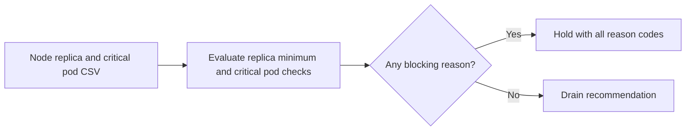

# Kubernetes Node Drain Planner

A planned node drain can reduce replica availability or disrupt a critical workload. Operators need to see the blockers before scheduling maintenance.

## What I built

I built a node maintenance preflight that checks available replicas against the supplied disruption floor and identifies critical pods. The JSON option gives a hold or drain recommendation with every reason code.

## How it works



[Architecture](docs/ARCHITECTURE.md) · [Decision rules and source](docs/RULES.md)

## Tools used

| Tool | Role in this repository |
| --- | --- |
| Python | [drain_planner.py](drain_planner.py) implements the CLI and decision rules. Uses `argparse` to parse command-line options, `csv` to read tabular exports, `json` to read or write structured records. |
| Make | Runs the documented example and the local `unittest` suite. |
| Python replay runner | Compares actual stdout with the checked-in baseline fixtures. |
| Ruff and Bandit | Developer lint and static security checks through `make check`. |

## Run the project

Use Python 3.10+ and Make. From the repository root:

```sh
python3 drain_planner.py sample_nodes.csv
```

Node A can drain. Node B is held, and JSON output identifies the reasons. [Full expected output](examples/Demo%201.stdout.txt)

### Additional replay cases

- **Hold evidence** · `python3 drain_planner.py sample_nodes.csv --json` · [Expected output](examples/Hold%20evidence.stdout.txt)

## Verify the project

```sh
make verify
make replay
```

`make replay` checks the recorded cases and exits nonzero if the output changes.
See the [developer guide](docs/DEVELOPMENT.md) for the pinned lint and security tools.

## Operating limits

The planner reads a snapshot. Recheck live PodDisruptionBudgets, pod placement, and workload health before draining.

[Case study](docs/CASE_STUDY.md) · [Operator runbook](docs/RUNBOOK.md) · [Verification report](reports/verification.md)
