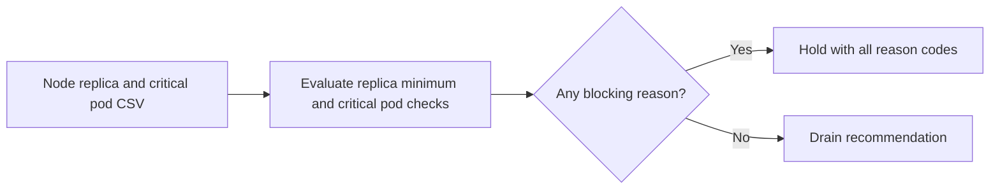

# Kubernetes Node Drain Planner

Plans safe node drains by checking replicas, pod disruption budgets, and critical workloads.

Focus: Telecom DevOps Kubernetes operations.

Built as a small, runnable Python project with clear input, output, sample data, and tests.

## Run

```bash
python3 drain_planner.py sample_nodes.csv
```

## Verify

```bash
python3 -m unittest discover . -v
```

## Local verification

Run `make verify` with Make and Python 3 installed. The target runs the documented sample through the project CLI. It also runs the existing Python unit tests.

## Project walkthrough



[Architecture and data flow](docs/ARCHITECTURE.md) · [Business problem, demo, and verification](docs/CASE_STUDY.md)

Use `python3 drain_planner.py sample_nodes.csv --json` to see replica counts
and hold reasons alongside each decision.
