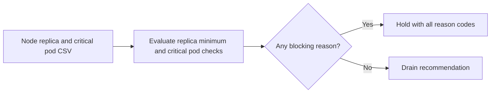

# Kubernetes Node Drain Planner architecture

Plans safe node drains by checking replicas, pod disruption budgets, and critical workloads.

## Operational boundaries

The documented run evaluates the bundled sample locally. Results depend on the quality and scope of the input. The demo makes no live infrastructure changes.

## Decision evidence

The evaluator emits the decision, replica counts, and each blocking reason.
The CLI renders the decision as concise text or JSON for a change review.
The planner evaluates an exported snapshot and never drains a live node.
